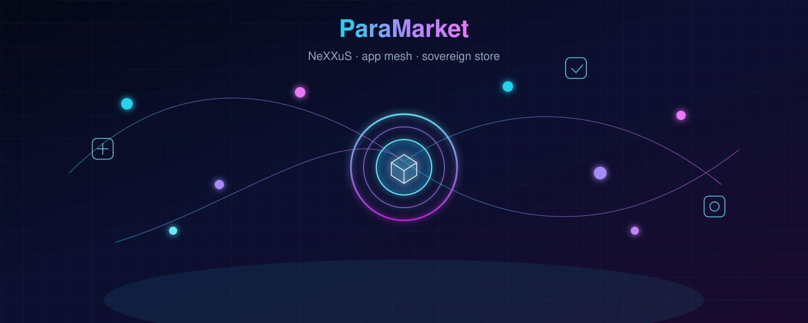
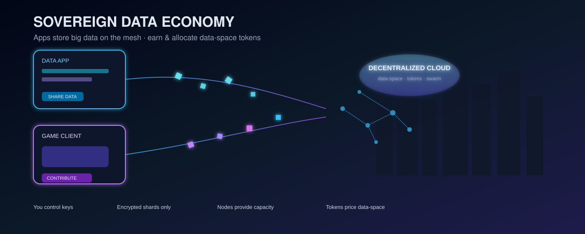

<p align="center">
  
</p>

# ParaMarket

**NeXXuS application store & sovereign data marketplace**

[English](#english) · [Русский](#русский) · [Español](#español)

---

<a id="english"></a>
## English

ParaMarket is the **application store and marketplace plane** of the NeXXuS crypto-internet: a place where apps are published, installed, and allowed to **store their big data on the peer swarm** in exchange for **allocated data-space and tokens** — without surrendering keys to a corporate cloud.

### The idea

Classic app stores rent you distribution. Classic clouds rent you disks and watch the metadata.  
ParaMarket + NeXXuS aim at something else:

1. **Identity** stays on the device (BIP39 vault, PIN-only unlock).
2. **Transport** is SimpleX (and friends) — an application protocol, not only human chat.
3. **Storage** is a decentralized mesh (NeXXuS Node): apps write encrypted shards, nodes earn for data-space.
4. **Market** is this repo: manifests, catalog, App SDK contracts, first-party shelf.

Apps never receive the mnemonic. They receive a **session** with scoped permissions after the host unlocks.

### Stack

| Layer | System |
|-------|--------|
| Identity + keyboard | [BIP39-SDK-GROK](https://github.com/PerfectFriend/BIP39-SDK-GROK) |
| Transport | SimpleX (`RustSimplex` / NeXXChat) |
| Storage mesh | NeXXuS Node (shards · Reed-Solomon · Tor) |
| Economy (optional) | [ParanoidX-Node](https://github.com/PerfectFriend/ParanoidX-Node) |
| **Store / App SDK** | **This repository** |

### Data-space bargain

```
App / game client
    → encrypts & shards “big data” locally
    → pays / stakes data-space tokens
    → swarm stores shards (nodes provide allocated capacity)
User keeps keys · nodes see ciphertext · catalog stays in ParaMarket
```

### Repository layout

```
ParaMarket/
├── docs/assets/     banners & media
├── docs/            scope, threat notes
├── schema/          nexxus-app manifest schema
├── catalog/         first-party shelf
├── sdk/             App SDK contracts
├── runtime/         host runtime notes
└── examples/        sample manifests
```

### First-party shelf (targets)

| Store id | Product |
|----------|---------|
| `nexxus.messenger` | Messenger on SimpleX transport |
| `nexxus.radio` | Radio Armageddon client |
| `nexxus.comics` | Nasreddin |
| `nexxus.feed.cats` | Catstagram |
| `nexxus.game.oracle` | Unified Oracle / tarot games |
| `nexxus.game.madgammon` | MadGammon |
| `nexxus.game.arcade` | Arcade pack |
| `nexxus.market.nailix` | NailiX services market |
| `nexxus.isle` | Isle community + economy UI |

### Policy

- PIN-only unlock in platform hosts (no biometrics as unlock factor)
- Seed never on the wire or in app APIs
- Auditor gates (**Колян**) per release train

### License

MIT (unless a subdirectory states otherwise).

---

<p align="center">
  
</p>

<a id="русский"></a>
## Русский

**ParaMarket** — плоскость **магазина приложений и рынка данных** крипто-интернета NeXXuS: сюда публикуют и ставят приложения, а они могут **хранить свою бигдату в пиринговом рое** в обмен на **выделенный датаспейс и токены** — без сдачи ключей корпоративному облаку.

### Идея

Обычный стор сдаёт вам витрину. Обычное облако сдаёт диск и читает метаданные.  
ParaMarket + NeXXuS устроены иначе:

1. **Идентичность** остаётся на устройстве (BIP39-vault, разблокировка только PIN).
2. **Транспорт** — SimpleX (и смежное): протокол для приложений, а не только чат «поболтать».
3. **Хранилище** — децентрализованная сеть (NeXXuS Node): приложения пишут шифрованные шарды, ноды зарабатывают за датаспейс.
4. **Маркет** — этот репозиторий: манифесты, каталог, контракты App SDK, first-party полка.

Приложения **не получают** мнемонику. После разблокировки хоста они получают **сессию** с ограниченными правами.

### Стек

| Слой | Система |
|------|---------|
| Идентичность + клавиатура | [BIP39-SDK-GROK](https://github.com/PerfectFriend/BIP39-SDK-GROK) |
| Транспорт | SimpleX (`RustSimplex` / NeXXChat) |
| Сеть хранения | NeXXuS Node (шарды · Reed-Solomon · Tor) |
| Экономика (опционально) | [ParanoidX-Node](https://github.com/PerfectFriend/ParanoidX-Node) |
| **Стор / App SDK** | **Этот репозиторий** |

### Сделка за датаспейс

```
Приложение / игровой клиент
    → локально шифрует и режет «бигдату»
    → оплачивает / стейкает токены датаспейса
    → рой хранит шарды (ноды дают выделенную ёмкость)
Ключи у пользователя · ноды видят шифротекст · каталог — в ParaMarket
```

### Политика

- Только PIN, без биометрии как фактора разблокировки
- Seed никогда не в сети и не в API приложений
- Аудиторские ворота (**Колян**) на каждом релизе

### Лицензия

MIT (если в подкаталоге не указано иное).

---

<a id="español"></a>
## Español

**ParaMarket** es el plano de **tienda de aplicaciones y mercado de datos** del cripto-internet NeXXuS: aquí se publican e instalan apps que pueden **guardar su big data en el enjambre P2P** a cambio de **espacio de datos asignado y tokens** — sin entregar las claves a una nube corporativa.

### La idea

Las tiendas clásicas alquilan distribución. Las nubes clásicas alquilan discos y observan metadatos.  
ParaMarket + NeXXuS proponen otra cosa:

1. La **identidad** permanece en el dispositivo (bóveda BIP39, desbloqueo solo con PIN).
2. El **transporte** es SimpleX (y afines): protocolo para aplicaciones, no solo chat humano.
3. El **almacenamiento** es una malla descentralizada (NeXXuS Node): las apps escriben fragmentos cifrados; los nodos ganan por data-space.
4. El **mercado** es este repositorio: manifiestos, catálogo, contratos del App SDK, estantería first-party.

Las apps **nunca** reciben el mnemónico. Tras el desbloqueo del host obtienen una **sesión** con permisos acotados.

### Stack

| Capa | Sistema |
|------|---------|
| Identidad + teclado | [BIP39-SDK-GROK](https://github.com/PerfectFriend/BIP39-SDK-GROK) |
| Transporte | SimpleX (`RustSimplex` / NeXXChat) |
| Malla de almacenamiento | NeXXuS Node (shards · Reed-Solomon · Tor) |
| Economía (opcional) | [ParanoidX-Node](https://github.com/PerfectFriend/ParanoidX-Node) |
| **Tienda / App SDK** | **Este repositorio** |

### El acuerdo de data-space

```
App / cliente de juego
    → cifra y fragmenta la “big data” en local
    → paga / hace stake de tokens de data-space
    → el enjambre guarda los shards (los nodos aportan capacidad)
Las claves quedan en el usuario · los nodos ven cifrado · el catálogo vive en ParaMarket
```

### Política

- Solo PIN; sin biometría como factor de desbloqueo
- El seed nunca viaja por la red ni aparece en APIs de apps
- Puertas de auditoría (**Колян**) en cada tren de release

### Licencia

MIT (salvo indicación en un subdirectorio).
